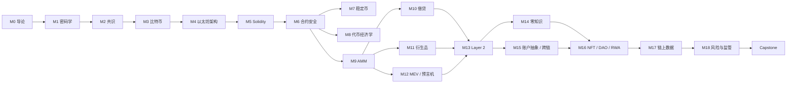

# Web 3.0：理论与实践

课程大纲见 [`SYLLABUS.md`](./SYLLABUS.md)。

## 进度

| 模块 | 讲义 | 实验 | 习题 | 状态 |
|---|---|---|---|---|
| M0 从 Web1 到 Web3 | [README](./modules/M00-intro/README.md) | [labs](./modules/M00-intro/labs/README.md) | [exercises](./modules/M00-intro/exercises.md) | ✅ v0.2 |
| M1 密码学基础 | [README](./modules/M01-cryptography/README.md) | [labs](./modules/M01-cryptography/labs/README.md) | [exercises](./modules/M01-cryptography/exercises.md) | ✅ v0.2 |
| M2 分布式共识 | [README](./modules/M02-consensus/README.md) | [labs](./modules/M02-consensus/labs/README.md) | [exercises](./modules/M02-consensus/exercises.md) | ✅ v0.2 |
| M3 比特币 | [README](./modules/M03-bitcoin/README.md) | [labs](./modules/M03-bitcoin/labs/README.md) | [exercises](./modules/M03-bitcoin/exercises.md) | ✅ v0.2 |
| M4 以太坊架构 | [README](./modules/M04-ethereum/README.md) | [labs](./modules/M04-ethereum/labs/README.md) | [exercises](./modules/M04-ethereum/exercises.md) | ✅ v0.2 |
| M5 Solidity 工程 | [README](./modules/M05-solidity/README.md) | [labs](./modules/M05-solidity/labs/README.md) | [exercises](./modules/M05-solidity/exercises.md) | ✅ v0.2 |
| M6 智能合约安全 | [README](./modules/M06-security/README.md) | [labs](./modules/M06-security/labs/README.md) | [exercises](./modules/M06-security/exercises.md) | ✅ v0.2 |
| M7 货币与稳定币 | [README](./modules/M07-money/README.md) | [labs](./modules/M07-money/labs/README.md) | [exercises](./modules/M07-money/exercises.md) | ✅ v0.2 |
| M8 代币经济学 | [README](./modules/M08-tokenomics/README.md) | [labs](./modules/M08-tokenomics/labs/README.md) | [exercises](./modules/M08-tokenomics/exercises.md) | ✅ v0.2 |
| M9 DEX 与 AMM | [README](./modules/M09-amm/README.md) | [labs](./modules/M09-amm/labs/README.md) | [exercises](./modules/M09-amm/exercises.md) | ✅ v0.2 |
| M10 借贷与信用 | [README](./modules/M10-lending/README.md) | [labs](./modules/M10-lending/labs/README.md) | [exercises](./modules/M10-lending/exercises.md) | ✅ v0.2 |
| M11 衍生品与收益 | [README](./modules/M11-derivatives/README.md) | [labs](./modules/M11-derivatives/labs/README.md) | [exercises](./modules/M11-derivatives/exercises.md) | ✅ v0.2 |
| M12 MEV 与预言机 | [README](./modules/M12-mev-oracles/README.md) | [labs](./modules/M12-mev-oracles/labs/README.md) | [exercises](./modules/M12-mev-oracles/exercises.md) | ✅ v0.2 |
| M13 Layer 2 | [README](./modules/M13-layer2/README.md) | [labs](./modules/M13-layer2/labs/README.md) | [exercises](./modules/M13-layer2/exercises.md) | ✅ v0.2 |
| M14 零知识证明 | [README](./modules/M14-zk/README.md) | [labs](./modules/M14-zk/labs/README.md) | [exercises](./modules/M14-zk/exercises.md) | ✅ v0.2 |
| M15 账户抽象与跨链 | [README](./modules/M15-account-abstraction/README.md) | [labs](./modules/M15-account-abstraction/labs/README.md) | [exercises](./modules/M15-account-abstraction/exercises.md) | ✅ v0.2 |
| M16 NFT / DAO / RWA | [README](./modules/M16-nft-dao/README.md) | [labs](./modules/M16-nft-dao/labs/README.md) | [exercises](./modules/M16-nft-dao/exercises.md) | ✅ v0.2 |
| M17 链上数据分析 | [README](./modules/M17-data/README.md) | [labs](./modules/M17-data/labs/README.md) | [exercises](./modules/M17-data/exercises.md) | ✅ v0.2 |
| M18 风险与监管 | [README](./modules/M18-risk-regulation/README.md) | [labs](./modules/M18-risk-regulation/labs/README.md) | [exercises](./modules/M18-risk-regulation/exercises.md) | ✅ v0.2 |
| Capstone | [README](./capstone/README.md) | — | — | ✅ v0.2 |

## 快速开始

```bash
npm install          # Node.js ≥ 20
npm run m0:trace     # M0：解析 Sepolia 上一笔最新交易（需联网）
npm run m1:cpp       # M1：C++ SHA-256 / Merkle 树（需 C++17 编译器）
npm run m1:js        # M1：依次运行全部 JS 实验
npm run labs         # 运行全部离线 JS 实验
npm run labs:online  # 连同需要联网的实验一起运行
npm run links        # 检查 Markdown 相对链接
npm run qa           # 结构 + 内容 + 链接 + 全部离线实验
```

## 学习路径



Part III（M7–M12）内部以 M9 为前置；M10–M12 可以按兴趣调整顺序。Capstone 建议在完成 Part I–III 后开始，M13–M18 可以与项目并行。

## 自测

打开 [`quiz.html`](./quiz.html)（单文件，无需安装依赖）：按模块作答，提交后显示参考答案与解析；简答题可对照参考答案自评。题库覆盖 M0–M18，各模块均配有讲义、实验与习题。答案与进度只保存在本机浏览器。

## 配套资料

- [`modules/README.md`](./modules/README.md)：全部模块的索引。
- [`notes/README.md`](./notes/README.md)：浅显版学习笔记，适合复习与查漏补缺。
- [`docs/MODULE_TEMPLATE.md`](./docs/MODULE_TEMPLATE.md)：模块与实验的编写规范。
- [`docs/glossary.md`](./docs/glossary.md)：课程术语表。
- [`docs/course-map.md`](./docs/course-map.md)：一页版课程地图与学习路线。
- [`docs/audit-report-template.md`](./docs/audit-report-template.md)：合约审计报告模板（M6 / Capstone）。
- [`docs/token-design-review-template.md`](./docs/token-design-review-template.md)：代币设计评审模板（M8 / Capstone）。
- [`docs/risk-assessment-template.md`](./docs/risk-assessment-template.md)：协议风险评估模板（M18 / Capstone）。
- [`CHANGELOG.md`](./CHANGELOG.md)：版本与新增内容记录。

## 目录约定

```
modules/M{nn}-{slug}/
├── README.md        讲义：学习目标 → 直觉 → 形式化 → 代码 → 案例 → 习题 → 延伸阅读
├── exercises.md     习题与参考答案
├── assets/          图片
└── labs/            实验代码（Node.js / Solidity / C++17）

docs/                写作规范、术语表与 Capstone 交付模板
capstone/            综合项目说明
scripts/             课程级检查与实验运行脚本
```

> ⚠️ 所有实验仅使用本地链与测试网，私钥与助记词均为公开测试值。
