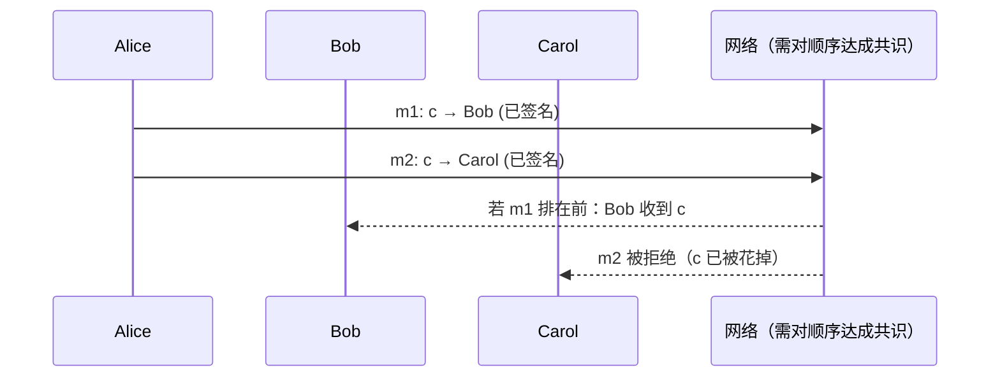
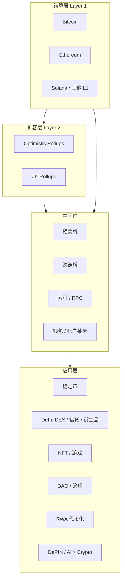

# M0 从 Web1 到 Web3：价值互联网

> 所属：Part 0 · 导论　｜　建议学时：1 周（理论 8 : 实践 2）　｜　截至 2026-10
> 前置：无　｜　后续：M1 密码学基础

---

## 学习目标

学完本章，你应能够：

1. 用"读 / 写 / 拥有"三个维度区分 Web1、Web2、Web3，并说清"拥有"在技术上对应什么；
2. 解释**双花问题**，以及为什么在区块链之前，数字价值转移必须依赖可信第三方；
3. 用**交易成本经济学**的语言说明区块链在经济上替代了什么、又引入了什么新成本；
4. 画出加密生态的全景图，并给每一类赛道找到一个"它在传统金融里对应什么"的类比；
5. 用 Nakamoto 系数等指标对"去中心化"做定量讨论，而不是只喊口号；
6. 在区块浏览器和 JSON-RPC 两个层面，读懂一笔以太坊交易的全部字段。

---

## 1. 直觉：互联网缺了什么？

互联网很擅长**复制**信息：一封邮件、一张图片发出去，你自己仍然留着一份。
复制对信息是优点，对**价值**却是灾难——如果我能把"一元钱"像图片一样复制，那它就一文不值。

所以在 Web3 之前，**互联网上的每一笔价值转移都要经过一个中心化记账者**：
支付宝、银行、Visa、SWIFT。它们维护一本账，说"这一元现在属于你，不再属于我"。

区块链要回答的问题只有一个：

> **能不能在没有可信中心记账者的情况下，让一群互不信任的人对同一本账达成一致？**

本课程的前半段（M1–M3）就是在拆解这个问题的答案：
- **密码学**（M1）解决"这笔钱是谁的、这条命令是谁发的"；
- **共识**（M2）解决"大家认同哪一个版本的账本"；
- **激励**（M2、M3、M8）解决"为什么有人愿意诚实地维护这本账"。

---

## 2. Web 的三次演进

| | Web1（约 1991–2004） | Web2（约 2004–今） | Web3（约 2015–今） |
|---|---|---|---|
| 核心能力 | 读 | 读 + 写 | 读 + 写 + **拥有** |
| 典型形态 | 门户网站、静态页面 | 社交网络、平台经济、云 | 公链、智能合约、钱包 |
| 数据归属 | 网站方 | 平台方 | 用户（私钥控制） |
| 身份 | 无 / 邮箱 | 平台账号（OAuth 登录） | 密钥对 / 钱包地址 |
| 盈利模式 | 广告、订阅 | 广告 + 数据 + 抽成 | 协议费用、代币、MEV |
| 信任对象 | 网站 | 平台 | 代码 + 共识 + 密码学 |

### 2.1 "拥有"在技术上意味着什么

在 Web2 里，你"拥有"一个游戏道具，实际意思是：**游戏公司的数据库里有一行记录，写着这个道具归你的账号 ID**。公司可以改它、删它、封你号。

在 Web3 里，"拥有"被严格定义为：

$$
\text{拥有资产 } A \iff \text{你持有能让状态机接受 } \texttt{transfer}(A) \text{ 指令的私钥}
$$

也就是说，所有权 = **对一段公开、确定性的状态转换规则的控制权**。这带来三个后果：

1. **可携带**：资产不依附于任何一个应用，任何前端都能读写它；
2. **可组合**：别人的合约可以无需许可地调用你的资产（"货币乐高"，M9–M11 详述）；
3. **不可撤销**：私钥丢了就是丢了，没有"找回密码"——自主托管的代价（M15 讲智能钱包如何缓解）。

> 💡 反思题：法律意义上的"所有权"（可诉诸法院）与技术意义上的"控制权"（持有私钥）在什么情况下会分离？（提示：被盗、继承、法院判决、交易所托管。）

---

## 3. 双花问题与可信第三方

### 3.1 双花（Double Spending）

设 Alice 有一枚数字货币 $c$。她同时签发两条消息：

- $m_1$：把 $c$ 给 Bob
- $m_2$：把 $c$ 给 Carol

两条消息都有 Alice 的合法签名——**签名只能证明"这是 Alice 发的"，不能证明"Alice 没有发过别的"**。
要防止双花，网络必须对**消息的顺序**达成一致，从而只承认先到的那一条。

这正是区块链的本质：**一个对交易全局排序的分布式协议**。

### 3.2 历史上的尝试

| 年份 | 方案 | 贡献 | 缺陷 |
|---|---|---|---|
| 1982 | Chaum 盲签名 / eCash (DigiCash) | 隐私电子现金 | 依赖中心化铸币方，公司 1998 年破产 |
| 1997 | Back 的 Hashcash | 用工作量证明对抗垃圾邮件 | 只是成本机制，不是货币 |
| 1998 | Wei Dai 的 b-money、Szabo 的 bit gold | 去中心化货币的构想 | 没有解决共识 |
| 2008 | **Nakamoto 的 Bitcoin** | PoW + 最长链 = 无许可共识 | 吞吐低、能耗高 |
| 2013–15 | **Buterin 的 Ethereum** | 图灵完备的通用状态机 | 复杂度与安全风险上升 |

> 比特币的突破不在于任何单一新技术——哈希、签名、Merkle 树、PoW 都早已存在——而在于**用经济激励把它们组合成一个开放参与的共识机制**。这就是为什么 Web3 天然是"计算机科学 × 经济学"的交叉学科。

---

## 4. 经济学视角：区块链替代了什么？

### 4.1 交易成本经济学

科斯（Coase, 1937）问：既然市场有效，为什么还需要企业？答案是**交易成本**——搜寻、谈判、签约、监督、执行的成本。威廉姆森（Williamson）进一步指出，当交易涉及**资产专用性、不确定性、机会主义**时，人们倾向于用科层组织（企业、平台）而非市场来协调。

区块链提出了第三种治理结构：

| 治理结构 | 信任来源 | 典型例子 | 主要成本 |
|---|---|---|---|
| 市场 | 价格 + 法律合同 | 现货交易 | 签约、执行成本 |
| 科层 / 平台 | 组织权威 | 淘宝、银行 | 代理成本、平台抽成、寻租 |
| **协议** | 密码学 + 共识 + 代码 | Uniswap、比特币 | 共识成本（gas）、代码风险、治理成本 |

### 4.2 "验证成本"与"组网成本"

Catalini & Gans（2016）提出一个简洁框架：区块链主要降低两类成本——

1. **验证成本（cost of verification）**：验证一笔交易属性（谁、何时、多少、是否已花）的成本；
2. **组网成本（cost of networking）**：在没有中心运营者的情况下启动并运营一个市场的成本（代币可用于补贴早期参与者）。

但它**提高**了另一类成本：每个全节点都要重复执行每笔交易。我们可以粗略写成：

$$
C_{\text{链上}} = \underbrace{N_{\text{节点}} \times c_{\text{执行}}}_{\text{冗余计算}} + \underbrace{c_{\text{共识}}}_{\text{挖矿 / 质押的机会成本}} + \underbrace{c_{\text{风险}}}_{\text{合约漏洞、治理攻击}}
$$

只有当 $C_{\text{链上}} < C_{\text{中介}}$（中介抽成 + 审查风险 + 准入限制的隐性成本）时，上链才在经济上划算。
这解释了为什么最早跑通的用例是**跨境、抗审查、高中介成本**的场景（如稳定币跨境转账），而不是"把奶茶店会员卡上链"。

---

## 5. 加密生态全景

| 赛道 | 传统金融 / 互联网类比 | 本课程章节 |
|---|---|---|
| 公链 L1 | 清算结算系统（如 CIPS、Fedwire）+ 操作系统 | M2–M4 |
| L2 | 交易所内部撮合 + 定期批量清算 | M13 |
| 稳定币 | 狭义银行、货币市场基金 | M7 |
| DEX / AMM | 交易所 + 做市商 | M9 |
| 借贷协议 | 回购市场、证券借贷、保证金贷款 | M10 |
| 永续 / 期权 | 期货、期权交易所 | M11 |
| 预言机 | 彭博、路透等数据供应商 | M12 |
| 跨链桥 | 代理行网络 | M15 |
| DAO | 公司治理、合作社 | M16 |
| RWA | 资产证券化、托管 | M16 |

---

## 6. 如何度量"去中心化"

"去中心化"不是二元的，而是多维的光谱。Buterin（2017）把它拆成三个维度：

- **架构去中心化**：有多少台物理机器？挂掉多少台系统仍可运行？
- **政治去中心化**：有多少个人 / 组织最终控制这些机器？
- **逻辑去中心化**：系统在逻辑上是"一个整体"（单一账本）还是"许多部分"？——区块链在逻辑上是**中心化**的（只有一本账），这正是它的价值。

### 6.1 Nakamoto 系数

Srinivasan & Lee（2017）定义：对某个子系统，按控制份额 $s_1 \ge s_2 \ge \dots$ 降序排列，

$$
N_{\text{Nakamoto}} = \min\left\{ k \;:\; \sum_{i=1}^{k} s_i > \theta \right\}
$$

其中阈值 $\theta$ 取决于攻击类型：PoW 双花常取 $\theta = 0.5$；BFT 类共识中阻止最终性只需 $\theta = 1/3$。
系数越大，需要合谋的实体越多，越难攻击。

> ⚠️ 要对**每个子系统**分别计算：挖矿 / 质押、客户端软件、节点托管云厂商、RPC 提供商、前端、开发者、稳定币发行方……整体的去中心化程度取决于**最薄弱的那一环**。

### 6.2 集中度的另一个视角：HHI

$$
\text{HHI} = \sum_{i} s_i^2 \quad (s_i \text{ 以百分比计时，范围 } 0\text{–}10000)
$$

美国司法部 / FTC 2023 年《合并指南》将 $\text{HHI} > 1800$ 视为高度集中市场，$1000\text{–}1800$ 为中度集中。我们会在 M17 对验证者、LST 发行方计算 HHI。

---

## 7. 炒作与实质：一个批判性框架

面对任何一个 Web3 项目，问四个问题：

1. **它需要区块链吗？** 如果所有参与方都信任同一个运营者，一个数据库就够了。
2. **价值从哪来？** 收益是来自真实的经济活动（交易费、借贷利差），还是来自新进资金或代币通胀？
3. **谁能拿走你的资产？** 列出所有能改变合约逻辑或冻结资产的密钥（管理员、多签、升级代理、预言机）。
4. **监管在哪？** 它是真正的技术创新、金融创新，还是只是**监管套利**？

| 常见说法 | 需要追问的事实 |
|---|---|
| "年化 200%" | 收益以什么计价？来源是手续费还是代币增发？ |
| "完全去中心化" | 合约可升级吗？谁持有升级密钥？Nakamoto 系数多少？ |
| "TVL 10 亿" | 有多少是重复计算（同一资产在多个协议间循环）？ |
| "已审计" | 审计了哪个版本？审计后有没有改代码？ |

---

## 8. 时效性提示（截至 2026-10）

以下内容变化快，学习时请以官方来源为准：
- 以太坊已完成 Dencun（2024，EIP-4844 blob）、Pectra（2025，EIP-7702 等）、Fusaka（2025 年末，PeerDAS）升级；后续升级以 [ethereum.org 路线图](https://ethereum.org/en/roadmap/) 为准；
- 美国 GENIUS 法案（2025）建立了支付型稳定币联邦框架；欧盟 MiCA 已全面实施；香港《稳定币条例》2025 年生效；
- **中国大陆**：2021 年《关于进一步防范和处置虚拟货币交易炒作风险的通知》明确虚拟货币相关业务活动属于非法金融活动。**本课程实践一律在本地链与测试网完成。**

---

## 9. 实践：读懂一笔以太坊交易

见 [`labs/`](./labs/README.md)：
- **Lab 0.1** 环境搭建（Node.js、项目依赖、可选 Foundry）
- **Lab 0.2** 用区块浏览器追踪一笔交易
- **Lab 0.3** 用 viem 直连 JSON-RPC，自己实现一个"迷你区块浏览器"：解析交易、收据、日志，并拆分手续费

---

## 10. 习题

见 [`exercises.md`](./exercises.md)（含参考答案）。

---

## 11. 延伸阅读

- Nakamoto, S. (2008). [Bitcoin: A Peer-to-Peer Electronic Cash System](https://bitcoin.org/bitcoin.pdf)
- Buterin, V. (2013). [Ethereum Whitepaper](https://ethereum.org/en/whitepaper/)
- Buterin, V. (2017). [The Meaning of Decentralization](https://medium.com/@VitalikButerin/the-meaning-of-decentralization-a0c92b76a274)
- Catalini, C. & Gans, J. (2016). *Some Simple Economics of the Blockchain*. NBER Working Paper 22952.
- Srinivasan, B. & Lee, L. (2017). *Quantifying Decentralization*. （earn.com 博客，可搜索标题获取）
- Narayanan, A. 等. *Bitcoin and Cryptocurrency Technologies*，第 0 章（前言与历史）
- Coase, R. (1937). *The Nature of the Firm*. Economica.
