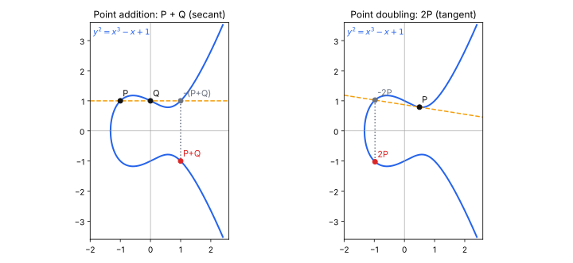
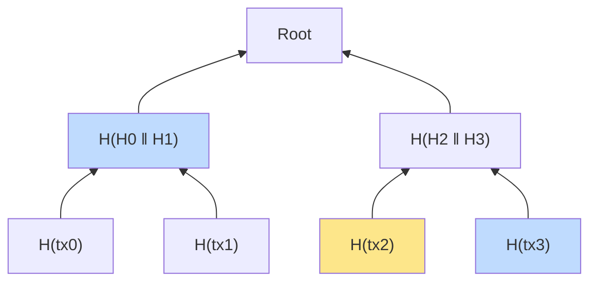
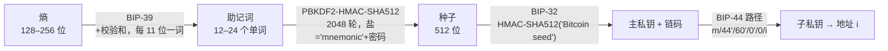

# M1 密码学基础

> 所属：Part I · 底层基础　｜　建议学时：1 周（理论 5 : 实践 5）　｜　截至 2026-10
> 前置：M0；模运算基础　｜　后续：M2 分布式共识、M3 比特币、M14 零知识证明

---

## 学习目标

1. 说出密码学哈希函数的三条安全性质，并用生日界估算碰撞攻击的代价；
2. 在有限域上做椭圆曲线点加、倍点、标量乘法，解释为什么"公钥易算、私钥难求"；
3. 完整推导 ECDSA 的签名、验证与公钥恢复，并解释以太坊交易为什么不需要 `from` 字段；
4. 证明随机数 $k$ 重用会泄露私钥，并说出 RFC 6979 的防御思路；
5. 比较 ECDSA、Schnorr、BLS 三种签名的结构与在区块链中的用途；
6. 构建 Merkle 树并生成 / 验证包含证明，说出域分离的意义；
7. 区分哈希承诺与 Pedersen 承诺，理解同态性的作用；
8. 解释 BIP-39 / 32 / 44 如何从 12 个单词派生出无穷多个地址，以及 xpub 的风险。

---

## 0. 本章地图：区块链用了哪些密码学？

| 需求 | 密码学工具 | 在区块链中的位置 | 本章小节 |
|---|---|---|---|
| 数据完整性、链式结构 | 哈希函数 | 区块哈希、交易 ID、地址 | §1 |
| "这笔钱是我的" | 数字签名 | 交易授权 | §2–§4 |
| 高效证明"某交易在区块里" | Merkle 树 | 交易根、状态根、轻客户端 | §5 |
| 先锁定、后公开 | 承诺方案 | 提交-揭示投票、机密交易、ZK | §6 |
| 一个种子管无数账户 | 密钥派生 | 钱包 | §7 |
| 工作量证明 | 哈希难题 | 比特币挖矿 | M2 |
| 隐私与扩容 | 零知识证明 | zkRollup | M14 |

> 💡 一个常见误解：区块链"加密"了数据。事实上公链上的数据**全部公开**，几乎不使用加密（encryption），用的是**哈希、签名与承诺**——它们保证的是**完整性与真实性**，而不是机密性。

---

## 1. 密码学哈希函数

### 1.1 定义与安全性质

哈希函数 $H: \{0,1\}^* \to \{0,1\}^n$ 把任意长输入映射为固定 $n$ 位输出。密码学哈希要求：

| 性质 | 形式化 | 通用攻击代价 | 区块链里依赖它的地方 |
|---|---|---|---|
| **抗原像**（单向性） | 给定 $y$，难以找到 $x$ 使 $H(x)=y$ | $2^n$ | 地址隐藏公钥、承诺的隐藏性 |
| **抗第二原像** | 给定 $x$，难以找到 $x' \ne x$ 使 $H(x')=H(x)$ | $2^n$ | 防止替换已上链的交易 |
| **抗碰撞** | 难以找到任意 $x \ne x'$ 使 $H(x)=H(x')$ | $2^{n/2}$ | Merkle 根、区块哈希的唯一性 |

另有两条工程上重要的性质：
- **雪崩效应**：输入改 1 位，输出约一半的位翻转；
- **谜题友好性（puzzle friendliness）**：对高熵的 $k$，给定 $y$，找 $x$ 使 $H(k \| x) = y$ 只能靠穷举——这是 PoW 的基础（M2）。

### 1.2 生日界

为什么抗碰撞只有 $2^{n/2}$ 的安全性？设随机产生 $q$ 个哈希值，至少一对碰撞的概率

$$
P(\text{碰撞}) \approx 1 - e^{-q(q-1)/(2 \cdot 2^n)} \approx \frac{q^2}{2^{n+1}}
$$

令 $P = 1/2$ 得 $q \approx 1.177\sqrt{2^n}$；首次碰撞的**期望**次数为 $\sqrt{\pi 2^n / 2} \approx 1.25 \cdot 2^{n/2}$。
直觉：23 个人里有两人同一天生日的概率就超过 50%（$365^{1/2} \approx 19$）。

所以 256 位哈希提供 **128 位**的抗碰撞安全性——这也是"128 位安全"这一说法的来源。
Lab 1.1 会让你在截断到 16 / 24 / 32 / 40 位的 SHA-256 上亲手找到碰撞，验证 $2^{n/2}$ 规律。

### 1.3 SHA-256 与 Keccak-256

| | SHA-256 | Keccak-256 |
|---|---|---|
| 结构 | Merkle–Damgård + Davies–Meyer 压缩函数 | 海绵结构（sponge） |
| 使用者 | 比特币（常用 **双重** SHA-256） | 以太坊（地址、函数选择器、存储槽、事件 topic） |
| 长度扩展攻击 | **易受攻击**：已知 $H(m)$ 和 $|m|$ 可算 $H(m \| \text{pad} \| m')$ | 不受影响 |

> ⚠️ 以太坊用的是 **Keccak-256**（原始提交版），**不是** NIST 最终标准化的 SHA3-256——两者填充规则不同，输出不同。代码里用 `keccak_256` 而不是 `sha3_256`。

**SHA-256 压缩函数**（Lab 1.1 中从零实现）：消息填充到 512 位的倍数后，每个块经过 64 轮运算更新 8 个 32 位状态字：

$$
T_1 = h + \Sigma_1(e) + \text{Ch}(e,f,g) + K_t + W_t, \quad T_2 = \Sigma_0(a) + \text{Maj}(a,b,c)
$$

其中 $\text{Ch}(e,f,g) = (e \wedge f) \oplus (\neg e \wedge g)$，$\text{Maj}(a,b,c) = (a\wedge b)\oplus(a\wedge c)\oplus(b\wedge c)$。

---

## 2. 有限域与椭圆曲线

### 2.1 有限域 $\mathbb{F}_p$

对素数 $p$，集合 $\{0, 1, \dots, p-1\}$ 在模 $p$ 的加法和乘法下构成域：每个非零元素都有乘法逆元。
求逆用**扩展欧几里得算法**，或费马小定理 $a^{-1} \equiv a^{p-2} \pmod p$。

### 2.2 椭圆曲线群

短 Weierstrass 形式：$E: y^2 = x^3 + ax + b \pmod p$，要求 $4a^3 + 27b^2 \not\equiv 0$。
曲线上的点加上"无穷远点" $\mathcal{O}$，在下述"点加"运算下构成**阿贝尔群**：

**几何直觉**（实数域上）：过 $P, Q$ 作直线交曲线于第三点，再关于 $x$ 轴翻折，得到 $P+Q$。

**代数公式**：设 $P=(x_1,y_1)$，$Q=(x_2,y_2)$，

$$
\lambda = \begin{cases} \dfrac{y_2 - y_1}{x_2 - x_1} & P \ne Q \quad (\text{割线}) \\[2ex] \dfrac{3x_1^2 + a}{2y_1} & P = Q \quad (\text{切线}) \end{cases}
\qquad
\begin{aligned} x_3 &= \lambda^2 - x_1 - x_2 \\ y_3 &= \lambda(x_1 - x_3) - y_1 \end{aligned}
$$

相反元 $-P = (x, -y)$，且 $P + (-P) = \mathcal{O}$。


*图：实数域曲线 $y^2 = x^3 - x + 1$ 上的点加（左）与倍点（右）。有限域上没有"直线"的直观图像，但代数公式完全相同。另见 Wikimedia Commons 的 [ECClines.svg](https://commons.wikimedia.org/wiki/File:ECClines.svg)。*

### 2.3 标量乘法与离散对数问题

$k \cdot P = \underbrace{P + P + \cdots + P}_{k\ \text{次}}$。用"倍点-加法"（类比快速幂）只需 $O(\log k)$ 次群运算：

```cpp
// 伪代码：double-and-add
Point mul(BigInt k, Point P) {
    Point R = O;                 // 无穷远点
    while (k > 0) {
        if (k & 1) R = R + P;
        P = P + P;               // 倍点
        k >>= 1;
    }
    return R;
}
```

**椭圆曲线离散对数问题（ECDLP）**：给定 $G$ 和 $Q = d \cdot G$，求 $d$。
已知最好的通用算法（Pollard $\rho$）需 $O(\sqrt{n})$ 次运算，$n$ 为 $G$ 的阶。这一**不对称性**是公钥密码学的根基：

$$
d \xrightarrow{\ \text{容易：}O(\log n)\ } Q = d\cdot G \qquad\qquad Q \xrightarrow{\ \text{困难：}O(\sqrt n)\ } d
$$

### 2.4 secp256k1

比特币和以太坊使用的曲线：$y^2 = x^3 + 7$ over $\mathbb{F}_p$，

- $p = 2^{256} - 2^{32} - 977$
- 基点 $G$ 的阶 $n \approx 2^{256}$（素数），余因子 $h = 1$
- 安全级别约 128 位（$\sqrt{n} \approx 2^{128}$）
- 特点：$a = 0$ 使运算更快；参数"无可疑之处"（不像 NIST P-256 的种子来源不透明），但当年并不主流

> **Lab 1.2** 在 $p = 17$ 的同形曲线上穷举所有点、画出点阵、列出 $G$ 生成的循环子群，并暴力破解离散对数——直观感受"同样的数学放大到 $2^{256}$ 后为何不可破"。

**密钥对**：私钥 $d \in [1, n-1]$ 是一个随机整数；公钥 $Q = d \cdot G$ 是曲线上的点。
- 未压缩公钥：`0x04 || X || Y`（65 字节）
- 压缩公钥：`0x02/0x03 || X`（33 字节，前缀表示 $Y$ 的奇偶，因为给定 $X$ 只有 $\pm Y$ 两种可能）

---

## 3. ECDSA 数字签名

### 3.1 算法

设消息摘要 $z = H(m)$ 截断为整数（以太坊 $H$ = Keccak-256）。

**签名**（私钥 $d$）：
1. 选取随机数 $k \in [1, n-1]$（**必须保密且每次不同**）
2. $R = k \cdot G$，$r = R_x \bmod n$（若 $r = 0$ 重选 $k$）
3. $s = k^{-1}(z + r\,d) \bmod n$（若 $s = 0$ 重选 $k$）
4. 输出 $(r, s)$

**验证**（公钥 $Q$）：
1. 检查 $r, s \in [1, n-1]$
2. $w = s^{-1} \bmod n$，$u_1 = z w$，$u_2 = r w$
3. $X = u_1 G + u_2 Q$，接受当且仅当 $X_x \equiv r \pmod n$

**正确性证明**：

$$
u_1 G + u_2 Q = s^{-1} z\, G + s^{-1} r\, d\, G = s^{-1}(z + r d)\, G = s^{-1} \cdot s k \, G = k G = R \qquad \blacksquare
$$

### 3.2 公钥恢复（ecrecover）

已知 $(r, s)$ 和 $z$，能否反解出 $Q$？由 $s k = z + r d$ 两边乘以 $G$：

$$
s R = z G + r Q \quad\Longrightarrow\quad Q = r^{-1}(s R - z G)
$$

$R$ 的 $x$ 坐标是 $r$，$y$ 坐标有两个候选（$\pm$）——用一个比特 $v$（recovery id / `yParity`）指明奇偶即可唯一确定。

**这就是以太坊交易里没有 `from` 字段的原因**：节点用 $(v, r, s)$ 从交易哈希恢复出公钥，再算出地址。Solidity 中的 `ecrecover(hash, v, r, s)` 预编译合约做的也是这件事。

### 3.3 签名可延展性

若 $(r, s)$ 有效，则 $(r, n - s)$ 也有效（相当于用 $-k$ 签名，$R$ 翻转为 $-R$，$x$ 坐标不变）。
后果：第三方可以在不知道私钥的情况下改变签名字节，从而改变**交易哈希**（比特币早期 Mt.Gox 事件的争议点之一）。
修复：以太坊 EIP-2 与比特币 BIP-62/146 要求 **low-s**：$s \le n/2$。

### 3.4 致命错误：随机数 $k$ 重用

若同一私钥用相同 $k$ 签了两条消息 $z_1, z_2$，则两个签名的 $r$ 相同，且

$$
\begin{aligned}
s_1 - s_2 &= k^{-1}(z_1 - z_2) &\Longrightarrow\quad k &= \frac{z_1 - z_2}{s_1 - s_2} \bmod n \\
s_1 k &= z_1 + r d &\Longrightarrow\quad d &= \frac{s_1 k - z_1}{r} \bmod n
\end{aligned}
$$

**私钥直接泄露。** 真实案例：索尼 PS3 固件签名（2010，$k$ 是常数）；安卓 `SecureRandom` 缺陷导致比特币钱包被盗（2013）。
更隐蔽的是：即使 $k$ 只是**有偏**（泄露少数几位），收集足够多签名后用**格攻击**也能恢复私钥。

**防御：RFC 6979 确定性签名**——$k = \text{HMAC-DRBG}(d, z)$。同一 $(d, z)$ 总得到同一 $k$，不同消息得到不相关的 $k$，彻底摆脱对随机数源的依赖。现代库常再混入额外熵（hedged signatures）以抵御故障注入攻击。

> **Lab 1.3** 从零实现 ECDSA 的签名、验证、公钥恢复，并与 `@noble/curves` 逐字节交叉验证；**Lab 1.5** 实际演示 $k$ 重用攻击。

---

## 4. 以太坊的签名约定

### 4.1 从私钥到地址

$$
\text{address} = \text{keccak256}(X \,\|\, Y)[12:32]
$$

即未压缩公钥去掉 `0x04` 前缀后的 64 字节做 Keccak-256，取**后 20 字节**。

**EIP-55 校验和**：对小写十六进制地址字符串再做一次 Keccak-256；若哈希的第 $i$ 个十六进制位 $\ge 8$，则地址第 $i$ 个字母大写。大小写混合本身就是校验码，抄错一位有约 $1 - 2^{-15}$ 的概率被发现（平均约 15 个字母位）。

### 4.2 消息签名标准

| 标准 | 摘要计算 | 用途 |
|---|---|---|
| 交易签名 | `keccak256(type ‖ RLP(tx fields))` | 链上交易 |
| **EIP-191**（`personal_sign`） | `keccak256("\x19Ethereum Signed Message:\n" ‖ len(m) ‖ m)` | 登录、链下声明 |
| **EIP-712**（类型化数据） | `keccak256(0x1901 ‖ domainSeparator ‖ hashStruct(m))` | permit、订单、意图（M5 详述） |

`\x19` 前缀保证签名的消息**不可能是一笔合法的 RLP 交易**——防止钓鱼网站诱导你"签个名登录"，实际签的是转账交易。EIP-712 的 `domainSeparator` 包含 `chainId` 和合约地址，防止跨链、跨合约重放。

> **Lab 1.4** 手动实现私钥 → 地址 → EIP-55 → EIP-191 签名 → ecrecover 的全流程，并与 viem 的结果逐字节比对。

---

## 5. Schnorr 与 BLS 签名

### 5.1 Schnorr 签名（BIP-340，比特币 Taproot）

**签名**：$R = kG$，$e = H(R \| P \| m)$，$s = k + e\,d \bmod n$，输出 $(R, s)$
**验证**：$sG \stackrel{?}{=} R + eP$

| | ECDSA | Schnorr |
|---|---|---|
| 公式 | 含 $k^{-1}$，非线性 | **线性**：$s = k + ed$ |
| 多签聚合 | 困难（需复杂 MPC） | 容易：MuSig2 把 $n$ 个签名者合成一个公钥、一个签名 |
| 可延展性 | 需 low-s 规则 | 原生不可延展 |
| 安全性证明 | 只在较强假设下 | 随机预言模型下可归约到 ECDLP |
| 专利历史 | 为绕开 Schnorr 专利而设计 | 专利已于 2008 年过期 |

**线性带来聚合**：两人各自 $s_1 = k_1 + e d_1$，$s_2 = k_2 + e d_2$，则 $s_1 + s_2 = (k_1+k_2) + e(d_1+d_2)$——正是聚合公钥 $P_1+P_2$ 对聚合 nonce $R_1+R_2$ 的签名（实际协议需额外防御"恶意密钥攻击"，见 MuSig2）。

### 5.2 BLS 签名（以太坊共识层）

BLS 基于**双线性配对** $e: G_1 \times G_2 \to G_T$，满足 $e(aP, bQ) = e(P, Q)^{ab}$。

- 私钥 $d$，公钥 $P = d \cdot g_1$
- 签名 $\sigma = d \cdot H(m)$，其中 $H$ 把消息哈希到 $G_2$ 上的点
- 验证：$e(g_1, \sigma) \stackrel{?}{=} e(P, H(m))$

**聚合**：同一消息的 $n$ 个签名直接相加 $\sigma_{\text{agg}} = \sum \sigma_i$，用聚合公钥 $P_{\text{agg}} = \sum P_i$ 一次验证：

$$
e(g_1, \textstyle\sum \sigma_i) = \prod e(g_1, d_i H(m)) = \prod e(d_i g_1, H(m)) = e(\textstyle\sum P_i, H(m))
$$

以太坊每个 epoch 有数十万验证者投票，BLS 聚合把它们压缩成少量 96 字节的签名。代价是配对运算较慢，且必须防御**恶意公钥攻击**（以太坊要求每个验证者质押时提交**持有证明** PoP）。

> **Lab 1.7** 用 64 个"验证者"演示 BLS 聚合：签名总大小从 6 KB 压缩到 96 B，验证时间缩短一个数量级。

---

## 6. Merkle 树

### 6.1 结构

把 $N$ 个数据块哈希为叶子，两两哈希向上合并，直到得到唯一的**根** (Merkle root)：



**包含证明**：要证明 `tx2` 在树中，只需提供兄弟节点路径（图中蓝色）：$H_3$ 与 $H_{01}$。验证者计算
$\text{Root}' = H(H_{01} \,\|\, H(H(tx_2) \,\|\, H_3))$，比对 $\text{Root}' = \text{Root}$。

| 操作 | 复杂度 |
|---|---|
| 构建 | $O(N)$ 次哈希 |
| 证明大小 | $\lceil \log_2 N \rceil$ 个哈希（100 万笔交易仅 20 × 32 = 640 字节） |
| 验证 | $O(\log N)$ 次哈希 |

这使**轻客户端**（SPV，M3）成为可能：只下载 80 字节的区块头，就能验证某笔交易已被打包。

### 6.2 域分离与奇数节点

两个经典陷阱：

1. **第二原像攻击**：若叶子与内部节点用同一种哈希，攻击者可以把内部节点 $(H_0 \| H_1)$ 当作一个 64 字节的"叶子数据"，伪造出一棵不同但根相同的树。
   **修复**（RFC 6962，证书透明度）：叶子 $= H(\texttt{0x00} \| d)$，内部节点 $= H(\texttt{0x01} \| L \| R)$。
2. **奇数节点复制**：比特币在某层节点数为奇数时**复制最后一个**节点，导致 `[a, b, c]` 和 `[a, b, c, c]` 的根相同（CVE-2012-2459）。
   **修复**：直接把落单节点提升到上一层，或在叶子数中编码长度。

### 6.3 以太坊里的 Merkle 结构（预告）

以太坊区块头包含三个根：`stateRoot`（世界状态）、`transactionsRoot`、`receiptsRoot`。状态用的是 **Merkle Patricia Trie**——一种结合前缀树的 Merkle 结构，支持按键（地址）高效查找与更新（M4 详述）。长期路线图计划迁移到 Verkle 树或基于哈希的二叉树，以缩小见证大小、支持无状态客户端。

> **Lab 1.1** 用 C++ 从零实现 SHA-256（通过 NIST 测试向量），在其上实现带域分离的 Merkle 树，并演示篡改检测。

---

## 7. 承诺方案

**承诺**（commitment）就像把一个值锁进保险箱交给对方：之后才交出钥匙"打开"。两条性质：
- **隐藏性**（hiding）：看承诺 $C$ 推不出值 $v$；
- **绑定性**（binding）：承诺之后无法改口打开成另一个值 $v' \ne v$。

| 方案 | 构造 | 隐藏性 | 绑定性 | 同态 | 用途 |
|---|---|---|---|---|---|
| 哈希承诺 | $C = H(v \| r)$ | 计算性 | 计算性（抗碰撞） | 无 | 提交-揭示投票、链上抽签 |
| Pedersen | $C = vG + rH$ | **完美** | 计算性（ECDLP） | **加法同态** | 机密交易、Bulletproofs |
| KZG 多项式承诺 | $C = f(\tau) \cdot G$ | — | 计算性（配对 + 可信设置） | 线性 | EIP-4844 blob、PLONK（M13、M14） |

**Pedersen 的同态性**：

$$
C(v_1, r_1) + C(v_2, r_2) = (v_1+v_2)G + (r_1+r_2)H = C(v_1+v_2,\ r_1+r_2)
$$

验证者可以在不知道金额的情况下检查"输入承诺之和 = 输出承诺之和"，即账目平衡（还需范围证明防止负数金额）。
关键前提：**没人知道 $\log_G H$**，否则绑定性失效。所以 $H$ 必须用哈希到曲线（hash-to-curve）从公开字符串生成（"nothing up my sleeve"）。

**提交-揭示（commit-reveal）模式**在合约中极常见：例如链上拍卖先提交 $H(\text{出价} \| \text{盐})$，截止后再揭示，防止他人跟价（M12 讨论它与 MEV 的关系）。

> **Lab 1.7** 演示 Pedersen 承诺的打开与同态加法。

---

## 8. 分层确定性（HD）钱包

### 8.1 三层标准



**BIP-39**：熵 $\text{ENT}$ 位 + 校验和 $\text{ENT}/32$ 位（SHA-256 的前几位），每 11 位查 2048 词表。
12 词 = 128 位熵 + 4 位校验和 = 132 位 = $12 \times 11$。可选的**密码**（"第 25 个词"）参与种子派生——相同助记词 + 不同密码 = 完全不同的钱包。

**BIP-32 子密钥派生**：

$$
I = \text{HMAC-SHA512}(c_{\text{par}},\ \text{data}), \quad I_L \,\|\, I_R = I, \quad k_{\text{child}} = (I_L + k_{\text{par}}) \bmod n, \quad c_{\text{child}} = I_R
$$

- **普通派生**（index $< 2^{31}$）：data $= \text{ser}_P(K_{\text{par}}) \| \text{index}$，只用父**公钥** → 持有扩展公钥 **xpub** 即可派生所有子公钥（交易所生成收款地址而无需在线私钥）。
- **硬化派生**（index $\ge 2^{31}$，记作 `i'`）：data $= \texttt{0x00} \| k_{\text{par}} \| \text{index}$，需要父**私钥**。

**BIP-44 路径**：`m / purpose' / coin_type' / account' / change / address_index`；以太坊为 `m/44'/60'/0'/0/i`。

### 8.2 xpub 泄露风险

由普通派生公式 $k_{\text{child}} = I_L + k_{\text{par}}$，而 $I_L$ 只依赖公开的 $(c_{\text{par}}, K_{\text{par}})$（都在 xpub 里）：

$$
\text{xpub} + \text{任意一个非硬化子私钥} \;\Longrightarrow\; k_{\text{par}} = k_{\text{child}} - I_L
$$

父私钥泄露，所有兄弟地址全部沦陷。这就是 BIP-44 在上三层强制使用硬化派生的原因。

> **Lab 1.6** 从助记词派生地址，验证与 Hardhat/Anvil 默认账户一致（`0xf39F…2266`），并演示 xpub 只读派生。

---

## 9. 安全实践要点

1. **永远不要自己实现密码学用于生产**——本章的从零实现只为理解原理。使用经审计的库：libsecp256k1、`@noble/curves`、OpenSSL。
2. 随机数来源只用操作系统 CSPRNG（`crypto.getRandomValues`、`/dev/urandom`），永远不要用 `Math.random()`。
3. 签名一律用 RFC 6979 或 hedged 签名。
4. 助记词离线、手写保存；任何"请输入助记词以验证钱包"的网站都是钓鱼。
5. 签名前看清签的是什么：盲签 EIP-712 `permit` 等同于把代币授权给对方（2025 年 Bybit 事件正是多签签名者被篡改的前端误导签名）。
6. **量子威胁**：Shor 算法可在多项式时间内解 ECDLP。以太坊与比特币社区都在研究后量子签名迁移路径（如基于哈希的签名、账户抽象下的签名方案替换）；地址只暴露公钥哈希、未曾签名过的账户暂时更安全。

---

## 10. 实验

见 [`labs/README.md`](./labs/README.md)。

| Lab | 语言 | 内容 |
|---|---|---|
| 1.1 | C++ | 从零实现 SHA-256；雪崩效应；生日攻击；Merkle 树与包含证明 |
| 1.2 | JS | $\mathbb{F}_{17}$ 上的玩具曲线：点阵、循环子群、暴力离散对数 |
| 1.3 | JS | 从零实现 ECDSA 签名 / 验证 / 公钥恢复；可延展性 |
| 1.4 | JS | 私钥 → 地址 → EIP-55；EIP-191 签名与 ecrecover |
| 1.5 | JS | 随机数 $k$ 重用攻击 |
| 1.6 | JS | BIP-39 / 32 / 44 HD 钱包；xpub |
| 1.7 | JS | Schnorr、BLS 聚合、Pedersen 承诺 |

## 11. 习题

见 [`exercises.md`](./exercises.md)（含参考答案）。

## 12. 延伸阅读

- Narayanan 等. *Bitcoin and Cryptocurrency Technologies*，第 1 章（密码学与加密货币）
- Boneh & Shoup. *A Graduate Course in Applied Cryptography*，第 8 章（哈希）、第 13、19 章（签名）——[toc.cryptobook.us](https://toc.cryptobook.us/)
- Corbellini, A. [Elliptic Curve Cryptography: a gentle introduction](https://andrea.corbellini.name/2015/05/17/elliptic-curve-cryptography-a-gentle-introduction/)（四篇系列博客，图解极佳）
- [SEC 2: Recommended Elliptic Curve Domain Parameters](https://www.secg.org/sec2-v2.pdf)（secp256k1 定义）
- [RFC 6979](https://datatracker.ietf.org/doc/html/rfc6979)（确定性 ECDSA）、[RFC 6962](https://datatracker.ietf.org/doc/html/rfc6962)（证书透明度 Merkle 树）
- [BIP-32](https://github.com/bitcoin/bips/blob/master/bip-0032.mediawiki)、[BIP-39](https://github.com/bitcoin/bips/blob/master/bip-0039.mediawiki)、[BIP-44](https://github.com/bitcoin/bips/blob/master/bip-0044.mediawiki)、[BIP-340](https://github.com/bitcoin/bips/blob/master/bip-0340.mediawiki)
- [EIP-55](https://eips.ethereum.org/EIPS/eip-55)、[EIP-191](https://eips.ethereum.org/EIPS/eip-191)、[EIP-712](https://eips.ethereum.org/EIPS/eip-712)
- Breitner & Heninger (2019). *Biased Nonce Sense: Lattice Attacks against Weak ECDSA Signatures in Cryptocurrencies*
