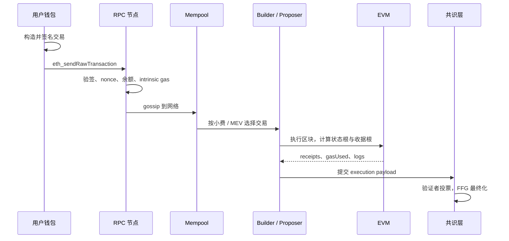
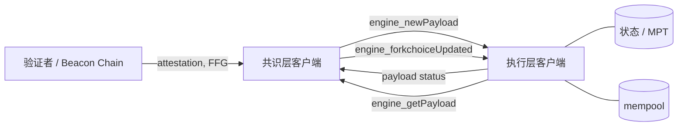

# M4 以太坊架构

> 所属：Part II · 以太坊与智能合约 ｜ 建议学时：1 周（理论 6 : 实践 4） ｜ 截至 2026-11
> 前置：M1 密码学、M2 分布式共识、M3 比特币 ｜ 后续：M5 Solidity 智能合约工程

## 学习目标

学完本章，你应能够：

1. 用**世界状态机**的语言描述以太坊：账户、nonce、余额、storage、code 如何组成状态，交易如何触发确定性的状态转换；
2. 解释 EVM 的栈、memory、storage、calldata 与 gas 计量，读懂一段字节码的执行轨迹并估算其 gas；
3. 画出交易从签名、mempool、打包、执行到收据与最终化的完整生命周期，并说明 nonce 在其中的作用；
4. 解释 Merkle Patricia Trie 的结构、状态根的计算与包含证明，并说明 Verkle 路线要解决什么问题；
5. 区分执行层（EL）与共识层（CL），说明 Engine API 如何把两者连接起来；
6. 推导 EIP-1559 的基础费公式并手算多块变化，解释 blob（EIP-4844）的独立费用市场；
7. 说明 Pectra / EIP-7702、Fusaka / PeerDAS 的机制与风险，以及客户端多样性、PBS / MEV-Boost 的工程含义。

## 本章地图

| 问题 | 工具 / 概念 | 在区块链中的位置 | 小节 |
|---|---|---|---|
| 全网如何维护同一份账？ | 世界状态机、账户模型 | 执行层状态 | §1 |
| 一笔交易如何被接受？ | 签名、nonce、mempool、收据 | 交易生命周期 | §2 |
| 合约代码在哪里运行？ | EVM、栈机、gas | 执行引擎 | §3 |
| 如何高效证明某个账户存在？ | MPT、RLP、状态根 | 状态承诺 | §4 |
| 共识与执行如何分工？ | Beacon Chain、Engine API | EL + CL | §5 |
| 手续费如何定价？ | EIP-1559、blob 费用市场 | 费用市场 | §6–§7 |
| 账户还能怎么升级？ | EIP-7702、Pectra、Fusaka | 协议演进 | §8 |
| 谁在出块、谁在排序？ | 客户端多样性、PBS / MEV-Boost | 验证者与区块市场 | §9 |

## 1. 直觉：一台由全世界共同维护的计算机

把以太坊想成一台**公开的、单线程的、按交易计费的状态机**。它有一个巨大的状态：

$$
\sigma: \text{address} \longmapsto (\text{nonce},\ \text{balance},\ \text{storageRoot},\ \text{codeHash})
$$

每个区块包含一批交易；每笔交易是一个**确定性的状态转换指令**。全世界所有全节点从同一个初始状态出发，按相同顺序执行同一批交易，必须得到相同的最终状态。否则状态根对不上，区块被拒绝。

这与比特币的 UTXO 模型不同：比特币的状态是“一堆未花费的输出”，以太坊的状态是“每个账户的余额和存储”。账户模型让“合约调用合约”变得自然，也使状态膨胀成为新问题。可以把以太坊类比成一台**永不关机的虚拟机**：每个账户是一块持久化磁盘，交易是提交给虚拟机的命令，gas 是 CPU 时间与磁盘 I/O 的计价器，状态根是每次命令执行后的校验和。

## 2. 形式化：世界状态与账户

### 2.1 两类账户

| | EOA（外部拥有账户） | 合约账户 |
|---|---|---|
| 控制者 | 私钥持有者 | 代码 |
| 发起交易 | 可以 | 不可以（只能被调用触发） |
| `codeHash` | 空代码哈希 | 部署字节码的哈希 |
| `storageRoot` | 空 trie 根 | storage trie 的根 |
| nonce 含义 | 已发送交易数 | 已创建合约数（EIP-161 起从 1 开始） |
| 私钥 | 有 | 无 |

EIP-7702（Pectra，2025-05）让 EOA 可以临时把 code 指向一个委托合约，模糊了这条边界；详见 §8。

### 2.2 nonce 与重放保护

EOA 的 nonce 是**严格递增**的。一笔交易声明 `nonce = n`，只有当前 nonce 恰好为 $n$ 时才合法；执行后 nonce 变为 $n+1$。这带来三个后果：

1. **重放保护**：同一笔签名交易不能被打包两次；
2. **顺序性**：同一账户的交易必须按 nonce 顺序执行，不能有空洞；
3. **替换**：想让卡住的交易加速，必须用相同 nonce、更高小费的交易替换它。

合约账户的 nonce 用于 `CREATE` 地址计算：`address = keccak256(rlp([sender, nonce]))[12:]`。`CREATE2` 则用 `keccak256(0xff || sender || salt || keccak256(init_code))[12:]`，地址不依赖 nonce，可预测。

### 2.3 状态转换函数

以太坊黄皮书把状态转换写成：

$$
\sigma' = \Upsilon(\sigma, B), \qquad \text{receipts} = \Pi(\sigma, B)
$$

其中 $B$ 是区块，$\Upsilon$ 执行区块内所有交易，$\Pi$ 生成收据。每笔交易 $\tau$ 可写成 $\sigma_{i+1} = \Lambda(\sigma_i, \tau)$。若交易失败（revert、out of gas），状态回滚，但 **gas 仍然被扣除**，nonce 仍然递增。这是 EVM 与数据库事务最关键的区别之一。

### 2.4 手算示例：一笔转账的状态变化

Alice 的账户：`nonce = 7`，`balance = 10 ETH`。她向 Bob 转 1 ETH，设置 `gasLimit = 21,000`、`maxFeePerGas = 20 gwei`、`maxPriorityFeePerGas = 1 gwei`，区块 `baseFee = 10 gwei`。

- 有效 gas 价格：$\min(20, 10+1)=11$ gwei；
- 手续费：$21{,}000 \times 11 = 231{,}000$ gwei $= 0.000231$ ETH；
- 其中销毁：$21{,}000 \times 10 = 210{,}000$ gwei $= 0.00021$ ETH；
- 给验证者的小费：$21{,}000 \times 1 = 21{,}000$ gwei $= 0.000021$ ETH；
- Alice 新余额：$10 - 1 - 0.000231 = 8.999769$ ETH；新 nonce：8；Bob 余额 +1 ETH；状态根改变。

## 3. 交易的生命周期

| 阶段 | 发生什么 | 关键检查 / 产物 |
|---|---|---|
| 构造 | 选择 type、nonce、gas、费用、`to`、`value`、`data` | EIP-1559 type 2、blob type 3、7702 type 4 |
| 签名 | 对交易哈希做 secp256k1 签名 | `(yParity, r, s)`；不含 `from` 字段 |
| 广播 | `eth_sendRawTransaction` 发给 RPC | RLP / typed envelope 编码 |
| mempool | 节点验证签名、nonce、余额、intrinsic gas | 按有效小费排序；可替换 |
| 打包 | builder / proposer 选择交易组成区块 | 区块 gas limit、blob 数量限制 |
| 执行 | EVM 逐条执行，扣 gas，修改状态 | 成功或 revert；未用完的 gas 退还 |
| 收据 | 记录 status、gasUsed、logs、bloom | `logsBloom` 供轻客户端过滤 |
| 最终化 | Casper FFG 检查点被最终化 | 约 2 个 epoch（12.8 分钟） |



**卡住的交易**：如果 nonce 出现空洞（例如 nonce 9 已打包，nonce 8 迟迟不到），后续交易会在 mempool 中等待。解决方式是广播缺失 nonce 的交易，或用相同 nonce、更高费用的交易替换。替换通常要求费用比原交易高约 10%。

## 4. 代码与实现：EVM 栈机与资源计量

### 4.1 四种数据位置

| 位置 | 生命周期 | 可写 | 成本 | 典型用途 |
|---|---|---|---|---|
| calldata | 单次调用 | 只读 | 便宜（4/16 gas 每字节） | 函数参数 |
| memory | 单次调用 | 可读写 | 按字节扩展，二次方增长 | 临时计算、ABI 编码 |
| storage | 跨交易持久 | 可读写 | 最贵（首次写 20,000 gas） | 合约状态 |
| transient storage | 单次交易 | 可读写 | 便宜（EIP-1153） | 重入锁、临时记账 |

EVM 是 **256 位栈机**：栈最多 1024 项，每项 32 字节；指令从栈顶取操作数。memory 是可按字节寻址的线性空间，扩展时按“字数”收取二次方费用：

$$
C_{\text{mem}}(w) = 3w + \lfloor w^2 / 512 \rfloor
$$

其中 $w$ 是 32 字节字的数量。storage 是 `key -> value` 的 32 字节映射，每个合约一棵 trie。

### 4.2 常用操作码与 gas

| 操作码 | 作用 | gas（近似） |
|---|---|---|
| `STOP` / `RETURN` / `REVERT` | 停止 / 返回 / 回滚 | 0 / 0 + memory |
| `ADD` / `MUL` | 算术 | 3 / 5 |
| `MLOAD` / `MSTORE` | memory 读写 | 3 + 扩展费 |
| `SLOAD` | 读 storage | 冷 2,100 / 热 100 |
| `SSTORE` | 写 storage | 首次 20,000；改写 2,900；清零退款 4,800 |
| `CALL` | 调用其他合约 | 700 + 地址访问 + gas 转发 |
| `DELEGATECALL` | 在自身上下文执行对方代码 | 700 + … |
| `LOG0`–`LOG4` | 事件 | 375 + 375×topic + 8×data |
| `CREATE` / `CREATE2` | 部署合约 | 32,000 + 代码存储费 |

> EIP-2929 引入冷 / 热访问：第一次访问地址或存储槽贵，之后在同一交易内变便宜。EIP-3529 把退款上限压到 `gasUsed / 5`，防止“用退款刷低费用”。

### 4.3 一笔交易的 intrinsic gas

一笔普通 ETH 转账至少需要：

$$
21{,}000 + 16 \times n_{\text{non-zero}} + 4 \times n_{\text{zero}}
$$

如果 calldata 很大，EIP-7623（Pectra）会提高“以 calldata 为主”的交易的底价，防止 blob / calldata 被滥用。合约部署还要加 `32,000` 基础费与代码存储费（每字节 200 gas）。

**手算**：一笔 `transfer(address,uint256)` 调用，calldata 68 字节，假设 4 个零字节、64 个非零字节：

$$
21{,}000 + 64 \times 16 + 4 \times 4 = 22{,}060
$$

再加上两次冷账户访问与两次 `SSTORE`（假设都是非零改非零）：$22{,}060 + 2 \times (2{,}100 + 2{,}900) = 32{,}060$。真实 ERC-20 转账常见 45,000–52,000 gas，因为收款方余额可能从零变为非零（`SSTORE` 20,000），还会触发事件与额外的地址访问。这个差距正好说明：**gas 估算必须看状态，而不能只看字节码**。

### 4.4 一段最小字节码

```text
PUSH1 0x02   // stack: [2]
PUSH1 0x03   // stack: [2, 3]
ADD          // stack: [5]
PUSH1 0x00   // stack: [5, 0]
MSTORE       // memory[0..32] = 5
PUSH1 0x20   // 返回 32 字节
PUSH1 0x00
RETURN
```

这段代码返回 32 字节的整数 5。EVM 的“编译器”工作就是把 Solidity 表达式翻译成这样的栈操作；`evm.codes` 或 `cast run` 可以单步查看每条指令的栈、memory 与 gas。

## 5. 状态树：Merkle Patricia Trie

以太坊用 **Merkle Patricia Trie（MPT）** 把“键值数据库”变成“可验证的承诺”。它是一棵 16 叉树（每个 nibble 一个分支），节点分三类：**分支节点**（17 项，前 16 项对应 nibble 0–15，第 17 项存放“键在此结束”的值）、**扩展节点**（共享同一段前缀时压缩路径）、**叶子节点**（剩余路径 + 值）。

路径用 **hex-prefix** 编码：高 nibble 的 bit 表示“叶子/扩展”和“奇偶长度”。节点用 **RLP** 序列化；若编码后小于 32 字节，直接内嵌在父节点；否则存哈希，父节点只放 32 字节哈希。根哈希就是**状态根**。

区块头里至少有四个根：`stateRoot`（所有账户的 MPT 根）、`transactionsRoot`（区块内交易）、`receiptsRoot`（所有收据）、`withdrawalsRoot`（提款列表，Shanghai 后）。每个账户的值是 `RLP([nonce, balance, storageRoot, codeHash])`。合约的 storage 是**另一棵** MPT，根为 `storageRoot`。因此“证明某合约的某个 storage 槽”需要两层证明：账户在状态树中的证明 + 槽在 storage trie 中的证明。

要证明账户 `0x1a2b…` 存在，只需提供从根到叶子的节点路径。验证者从 `stateRoot` 开始，逐段匹配 nibble，重算每个节点的哈希。

| 操作 | 复杂度（$N$ 个账户） |
|---|---|
| 查找 / 更新 | $O(\log_{16} N)$ 个节点 |
| 包含证明大小 | $O(\log_{16} N)$ 个节点，约 3–10 个 |
| 全状态存储 | $O(N)$，但节点共享前缀，远小于朴素表 |

**手算**：20 字节地址 = 40 个 nibble。若 $N = 2^{32}$ 个账户，理想深度约 $\log_{16} 2^{32} = 8$ 层；实际因前缀分布与路径压缩，证明通常 6–10 个节点，约几百字节。相比把整个状态发给轻客户端，这是巨大的压缩。

> 路线图：Verkle 树用向量承诺替代逐层哈希，把证明从“每层一个哈希”压缩成“一个常数大小的证明”，为无状态客户端铺路。截至 2026-11，主网仍是 MPT；Verkle 的部署时间以官方路线图为准。

## 6. 合并后的架构：执行层 + 共识层

2022-09 的 The Merge 把以太坊拆成两层：**执行层（EL）**负责 EVM、状态、mempool、JSON-RPC，执行交易并产生 `ExecutionPayload`；**共识层（CL）**负责 Beacon Chain、验证者、attestation、Casper FFG，决定“哪一个执行区块是规范的”。

CL 把验证者组织成 **slot（12 秒）** 与 **epoch（32 slot，6.4 分钟）**。每个 slot 有一个提议者出块，委员会对区块投票。FFG 需要 2/3 质押投票才能最终化；两个 epoch 后检查点最终化，回滚成本极高。

两层通过 **Engine API** 通信（认证端口 8551，JWT 保护）：`engine_newPayloadV4`（CL → EL，提交执行区块并验证）、`engine_forkchoiceUpdatedV3`（更新头 / 安全 / 最终化区块，并可请求出块）、`engine_getPayloadV4`（取回 EL 构建好的 execution payload）。



这种拆分让共识与执行可以独立客户端实现、独立升级，也带来了“执行层客户端多样性”的新风险（§9）。

## 7. 费用市场：EIP-1559 与 blob

### 7.1 EIP-1559 基础费

每个区块有一个**基础费** $b_t$，由父块 gas 使用量决定：

$$
b_{t+1} = b_t \left(1 + \frac{1}{8} \cdot \frac{g_t - g^*}{g^*}\right), \qquad g^* = \frac{\text{gasLimit}}{2}
$$

- 目标 gas $g^*$ 是区块 gas limit 的一半（elasticity = 2）；
- 实际实现用整数除法，单块最多变化 $\pm 12.5\%$；
- 基础费**全部销毁**，不进入验证者口袋；
- 用户支付的有效价格：$\min(\text{maxFeePerGas},\ b_t + \text{maxPriorityFeePerGas})$；
- 小费 = 有效价格 − 基础费；若 `maxFee < baseFee`，交易不可打包。

**手算 1**：$b_t = 12$ gwei，$g^* = 15$M：满块 $g_t = 30$M 时 $12 \times (1 + 1/8) = 13.5$ gwei；空块 $12 \times (1 - 1/8) = 10.5$ gwei；半满 $12 \times (1 + 1/16) = 12.75$ gwei。**手算 2**：连续 10 个满块，$b_0 = 10$ gwei，则 $b_{10} = 10 \times (9/8)^{10} \approx 10 \times 3.2473 = 32.4732$ gwei。**手算 3**：52,000 gas，`baseFee = 12`，`maxFee = 30`，`tip = 2`：有效价格 14 gwei，总费 $52{,}000 \times 14 = 728{,}000$ gwei $= 0.000728$ ETH；销毁 $52{,}000 \times 12 = 624{,}000$ gwei；小费 $52{,}000 \times 2 = 104{,}000$ gwei。

为什么销毁？它让基础费成为“网络拥堵的租金”，不被矿工 / 验证者截留，也抵消 ETH 的部分通胀。自 2021-08 伦敦升级以来，累计销毁约 460 万 ETH（截至 2026-11，实时数据见 ultrasound.money）。为什么是 ±12.5%？如果基础费变化太快，用户难以预测费用；太慢，则拥堵持续时间过长。1/8 的调整率让基础费在约 10 个满块内翻倍，在约 10 个空块内减半，兼顾响应速度与稳定性。目标 gas 是 limit 的一半，则允许区块短时翻倍吞吐，同时用费用把长期需求压回目标。

### 7.2 blob（EIP-4844）

blob 交易（type 3）携带大块数据（每个 blob 131,072 字节 = 4096 个 field element × 32 字节），但 **EVM 不能直接读取 blob 内容**，只能看到 `blobVersionedHashes`。blob 有自己的费用市场：

$$
\text{excessBlobGas}_{t+1} = \max(0,\ \text{excessBlobGas}_t + \text{blobGasUsed}_t - \text{targetBlobGas})
$$

$$
\text{blobBaseFee} = \text{fakeExponential}(1,\ \text{excessBlobGas},\ 3{,}338{,}477)
$$

`fakeExponential` 是整数泰勒级数，保证所有客户端逐位一致。blob 基础费独立于普通 gas，因此 L2 的数据可用性成本不会和 L1 用户直接抢同一块费用市场。

| 时期 | target blobs | max blobs | target blob gas |
|---|---|---|---|
| Dencun（2024-03） | 3 | 6 | 393,216 |
| Pectra（2025-05，EIP-7691） | 6 | 9 | 786,432 |

**手算**：Dencun 参数下，每块打满 6 个 blob，连续 20 块：每块超额 $= 6 - 3 = 3$ 个 blob $= 393{,}216$ blob gas；20 块后 `excessBlobGas = 7,864,320`；`blobBaseFee = fakeExponential(1, 7,864,320, 3,338,477) = 10` wei。与执行层动辄几十 gwei 相比，blob 费用极低，这正是 L2 费用在 Dencun 后大幅下降的原因。blob 数据约 18 天后被剪枝（4096 个 epoch），历史数据由 L2 / 归档节点保存。

## 8. Pectra、EIP-7702 与 Fusaka

### 8.1 Pectra（2025-05 主网）

| EIP | 内容 |
|---|---|
| EIP-7702 | 让 EOA 设置委托代码，获得智能账户能力 |
| EIP-7251 | 验证者最大有效余额从 32 ETH 提高到 2048 ETH |
| EIP-7002 | 执行层可触发验证者提款 |
| EIP-6110 | 把存款直接放进执行层区块，简化 CL 处理 |
| EIP-7691 | blob target / max 提高到 6 / 9 |
| EIP-7623 | 提高 calldata 密集型交易的底价 |
| EIP-2537 | BLS12-381 预编译，便于聚合签名验证 |

### 8.2 EIP-7702 的机制与风险

EOA 可以签署一个 **authorization**，把 `code` 设为 `0xef0100 || delegate_address`。之后对该 EOA 的调用会像 `delegatecall` 一样执行 `delegate_address` 的代码，但使用 EOA 自己的地址、余额与 storage。authorization 包含 `chainId` 与 nonce，可防止跨链重放；把 delegate 设为零地址即可撤销。用途包括批量交易、gas 赞助、社交恢复、会话密钥——相当于把 EOA 升级成智能账户，而不必迁移资产。

风险：**恶意委托**（钓鱼网站诱导用户签署指向恶意合约的 authorization，合约可以转走 EOA 的全部资产）、**sweeper**（攻击者监控链上，一旦发现高价值 EOA 设置委托，立即调用恶意逻辑）、**存储冲突**（委托合约的 storage 布局直接作用于 EOA 的 storage，必须使用命名空间 ERC-7201 或明确的布局约定）、**初始化**（EOA 没有 constructor，委托合约的初始化必须防重放 / 防抢跑）。

### 8.3 Fusaka（2025-12 主网）与后续

Fusaka 的核心是 **PeerDAS（EIP-7594）**：把 blob 数据切成列（column），节点只需下载并抽样部分列，就能为数据可用性投票。这样可以在不增加单节点带宽的情况下提高 blob 数量，为 L2 扩容铺路。Fusaka 还包含交易 gas 上限、blob 费用边界等调整。截至 2026-11，Dencun、Pectra、Fusaka 均已主网激活；Glamsterdam 等后续升级的 ePBS（EIP-7732）、FOCIL（EIP-7805）等仍在路线图中。**具体激活时间与新 EIP 以 ethereum.org / ethereum Cat Herders 的官方公告为准。**

## 9. 客户端多样性、PBS 与 MEV-Boost

执行层客户端：Geth、Nethermind、Besu、Erigon、Reth；共识层客户端：Lighthouse、Prysm、Teku、Nimbus、Lodestar、Grandine。如果某个客户端占比超过 2/3，它的一次共识 bug 可能让网络最终化错误链；如果超过 1/3，可能阻止最终化。2016 年 Geth 的 DoS 事件、2023 年 Prysm 的共识 bug 都说明：**多样性不是口号，而是生存策略**。实时份额见 clientdiversity.org，目标是没有客户端超过 1/3。

**PBS（proposer-builder separation）** 把“构建区块”与“提议区块”分开：**searcher** 发现 MEV 机会，提交 bundles；**builder** 组装区块，向 relay 提交竞价；**relay** 验证区块并隐藏内容，防止 proposer 偷看；**proposer** 选择最高竞价，签名区块头；**MEV-Boost** 是合并后主网最常用的 PBS 实现，多数区块通过 relay 构建。这提高了 proposer 的收益，但也引入了**信任中介**：relay 可以看到区块内容，可能审查交易；builder 可能集中化。ePBS 试图把 relay 的角色写进协议，减少信任假设。MEV 的完整讨论见 M12。

### 案例：合并、Pectra 与 Bybit

The Merge（2022-09）PoW 转 PoS，能耗下降约 99.95%；EIP-1559（2021-08）累计销毁约 460 万 ETH（截至 2026-11）；Dencun（2024-03）blob 上线后，主流 L2 的平均交易费一度下降一个数量级以上；Pectra（2025-05）EIP-7702 让 EOA 获得智能账户能力，也带来新的钓鱼面；Bybit 事件（2025-02）Safe 多签前端被篡改，签名者盲签恶意 `delegatecall`，损失约 14.6 亿美元——运营安全与前端供应链的教训（M6 详述）。

## 10. CS / 工程视角

| 本章概念 | 已有计算机知识 | 对应关系 |
|---|---|---|
| 世界状态机 | 复制状态机（Raft / Paxos） | 所有节点执行相同命令序列，得到相同状态 |
| EVM | 栈式虚拟机 / 字节码解释器 | 256 位栈机，gas 是 CPU 与内存的资源计价 |
| gas | 资源计量 / 配额 | 防止无限循环；把计算、存储、带宽统一计价 |
| MPT | 持久化数据结构 / 前缀树 | 结构共享、路径压缩、哈希承诺 |
| mempool | 优先队列 / 交易缓冲区 | 按有效小费排序，nonce 约束形成偏序 |
| Engine API | 关注点分离 / 进程间 RPC | 共识与执行独立演进，JWT 认证 |
| PBS | 市场设计 / 供应链 | 搜索者、builder、relay、proposer 的分工与信任 |
| 状态根 | 校验和 / 版本控制 | 一个 32 字节值承诺全部状态，便于轻客户端验证 |

从数据库角度看，以太坊是一个**只追加的日志 + 物化状态**：区块是 WAL，状态是物化视图；reorg 是回滚未最终化的日志；最终化是不可逆的提交点。从软件工程角度看，EVM 的确定性、gas 的可计量性与 ABI 的稳定性，是智能合约可验证、可组合的基础。

## 11. 常见误区

1. **“交易失败会退还 gas”** → 错。失败只退还未使用的 gas；已经消耗的 gas 照扣，nonce 也递增。
2. **“baseFee 给小费给验证者”** → 错。baseFee 全部销毁；只有 priority fee 给验证者。
3. **“nonce 可以跳过”** → 错。EOA 交易必须严格连续；空洞会阻塞后续交易。
4. **“blob 数据可以被合约读取”** → 错。EVM 只能看到 blob 的版本化哈希；数据可用性由共识层保证，执行层不读取内容。
5. **“合并后没有矿工，所以没有 MEV”** → 错。MEV 来自交易排序权，PoS 下依然存在，只是分配方式变化。
6. **“客户端多样性只关乎意识形态”** → 错。单一客户端 supermajority 会把软件 bug 放大成全网故障。

## 12. 实践

见 [`labs/README.md`](./labs/README.md)：**Lab 4.1** EIP-1559 基础费与 blob 费用市场模拟（离线，含解析解对照）；**Lab 4.2** 从零实现 RLP + 简化 MPT，生成 / 验证包含证明，执行转账并拒绝重放（离线）；**Lab 4.3** 用 viem 读取 Sepolia 区块、费用历史与 storage（可选联网）。

## 13. 习题

见 [`exercises.md`](./exercises.md)（含参考答案）。B 部分全部可手算，建议先手算再用 Lab 4.1 核对。

## 14. 延伸阅读

- Ethereum Yellow Paper（Wood, 2014，持续更新）：[ethereum.github.io/yellowpaper/paper.pdf](https://ethereum.github.io/yellowpaper/paper.pdf)
- EIP-1559（基础费）、EIP-4844（blob）、EIP-7702（EOA 委托）：[eips.ethereum.org](https://eips.ethereum.org/)
- ethereum.org：[Ethereum roadmap](https://ethereum.org/en/roadmap/)、[EVM opcodes](https://ethereum.org/en/developers/docs/evm/opcodes/)
- evm.codes：交互式操作码与 gas 参考：[evm.codes](https://www.evm.codes/)
- Buterin, V. et al. *Ethereum Proof-of-Stake Consensus Specifications*：[github.com/ethereum/consensus-specs](https://github.com/ethereum/consensus-specs)
- Daian, P. et al. (2019). *Flash Boys 2.0: Frontrunning in Decentralized Exchanges, Miner Extractable Value, and Consensus Instability*（MEV 与 PBS 的背景）
- clientdiversity.org：客户端份额与风险说明
